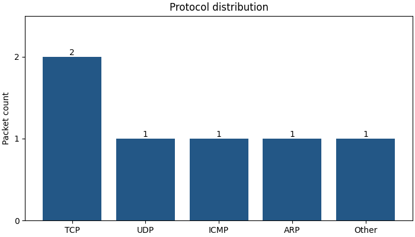

# Network Traffic Analyzer ? Python, PCAP & Matplotlib
Built an offline Python CLI that summarizes Ethernet PCAP files and generates protocol-distribution charts. Verified packet counts, chart generation, and error handling with a reproducible synthetic capture.

## Overview and problem

Manually reading a long packet list makes it difficult to estimate protocol distribution. This offline Python tool reads an authorized Ethernet capture in classic PCAP format, prints counts and captured-byte statistics, and writes a PNG bar chart.

## Learning objectives

Practice decoding Ethernet, IP and transport headers, counting each frame once, and interpreting protocol statistics in the context of one capture.

## Technologies and features

Python 3.10+, dpkt for decoding, and Matplotlib for headless chart generation. Categories are TCP, UDP, ICMP (including ICMPv6), ARP and Other. The tool handles missing files and invalid capture headers with an error message.

## Repository structure

- `analyzer.py` reads the capture, classifies frames, and creates the chart.
- `make_sample.py` generates six synthetic packet records on disk.
- `requirements.txt` pins the direct dependencies.
- [Development notes](docs/development-notes.md), [testing guide](docs/testing-guide.md) and [concepts](docs/concepts.md) in`docs/` explain the implementation and the networking background.

## Installation and use

From the repository root in Ubuntu or WSL:

```bash
python3 -m venv .venv
source .venv/bin/activate
python -m pip install -r requirements.txt
python make_sample.py
python analyzer.py sample.pcap
```

## Results and observations

I ran the analyzer in WSL on the generated six-packet sample. It counted 255
captured bytes: two TCP packets and one each of UDP, ICMP, ARP, and Other. I
verified that it generated a PNG chart, reported errors for missing and invalid
captures, and preserved the existing chart when I reused its output path.

| Test | Action | Result |
|---|---|---|
| Sample | Run `python analyzer.py sample.pcap` | Six total, 255 bytes, TCP 2 and all other categories 1 |
| Chart | Open `protocols.png` | Five bars with labels 2, 1, 1, 1, 1 |
| Missing | Run `python analyzer.py missing.pcap --chart missing.png` | Error for missing file and no PNG |
| Invalid | Run `echo invalid > invalid.pcap`, then `python analyzer.py invalid.pcap --chart invalid.png` | Error for invalid capture and no PNG |
| Existing output | Run `python analyzer.py sample.pcap` again | Existing-file error preserves the original chart |



## Limitations

Input must be classic PCAP with Ethernet frames. PCAPNG and other link types require conversion or export. Unknown or undecodable frames can fall into Other. Captured lengths may differ from wire lengths, and the tool performs no per-flow analysis or security verdicts.

## Learning reflection and next steps

The implementation illustrates how header order determines the category and how the same counts feed the text and chart. A future version could support PCAPNG and summarize traffic by time window.

### Development Acknowledgment

This project was developed as part of my independent learning in cybersecurity and Python, with AI assistance throughout the development process. My involvement included reviewing and understanding the implementation, testing the application, troubleshooting issues, and documenting what I learned.